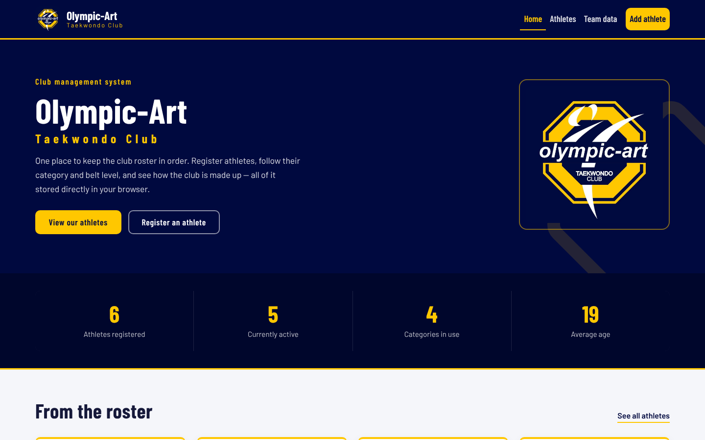
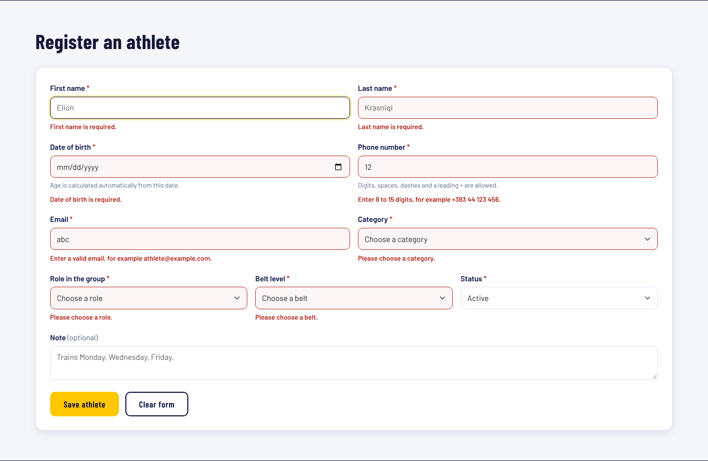
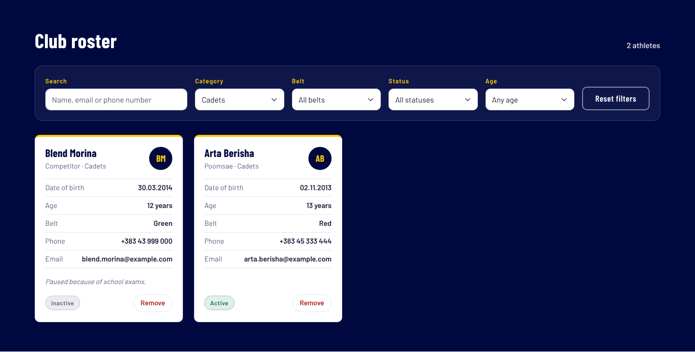
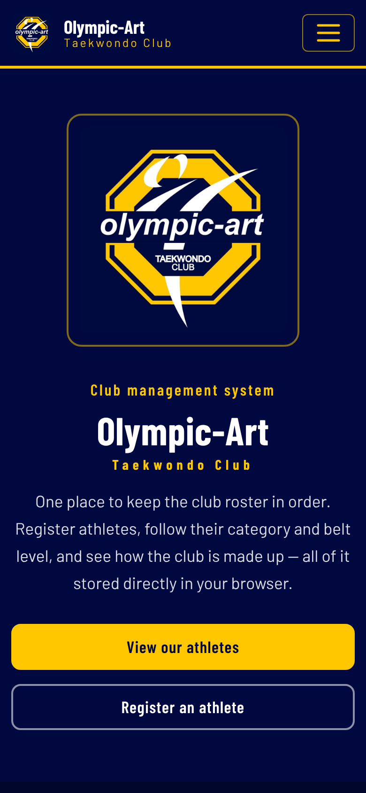
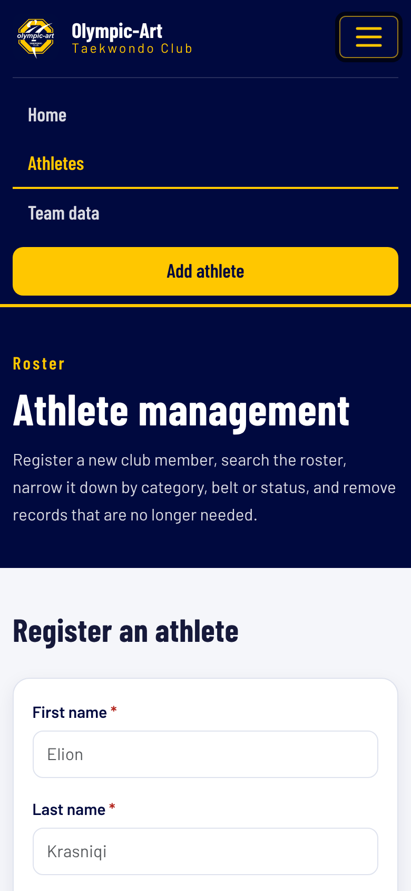

# Olympic-Art Athlete Manager

A front-end web app for managing the roster of a Taekwondo club: register athletes, search and filter them, see club statistics, and load data from an external API. It runs entirely in the browser, with no backend and no build step.

Built as my final project for the *Interactive Web Programming* course in the Web and Mobile Application Developer programme at **Cacttus Education** (Prishtina, Kosovo), September 2026. The club theme comes from Olympic-Art Taekwondo Club, where I train.



> **Live demo:** [elionagushi-ce.github.io/olympic-art-athlete-manager](https://elionagushi-ce.github.io/olympic-art-athlete-manager/)

---

## Features

| Area | What it does |
|---|---|
| **Athlete registration** | Form with 9 required fields; every field is validated in JavaScript with its own error message |
| **Roster** | Athlete cards created with `document.createElement`, newest first |
| **Search and filters** | Live search on name, email and phone, combined with category, belt, status and age-range filters |
| **Delete with confirmation** | Bootstrap modal before a record is removed (falls back to `confirm()` if Bootstrap is unavailable) |
| **Persistence** | Data saved in `localStorage`; six example athletes are added on the first visit |
| **Dashboard** | Total athletes, active athletes, categories in use and average age, plus a per-category table |
| **External API page** | Fetches products from dummyjson.com with loading, error and retry states, and a button that triggers a failed request on purpose to demonstrate error handling |
| **Responsive layout** | Desktop, tablet and mobile breakpoints (991px and 575px), collapsible navigation |

| Validation | Filtered roster |
|---|---|
|  |  |

| Mobile | Mobile navigation |
|---|---|
|  |  |

---

## Tech stack

- **HTML5**: semantic structure (`header`, `nav`, `main`, `section`, `article`, `footer`), accessible labels and ARIA attributes
- **CSS3**: custom properties, Flexbox, CSS Grid, media queries, `prefers-reduced-motion`
- **JavaScript (ES2017, no framework)**: DOM manipulation, event delegation, `async`/`await` with the Fetch API, `localStorage`
- **Bootstrap 5.3**: navbar collapse, grid, form styles, modal and spinner (loaded from a CDN)
- **Google Fonts**: Barlow and Barlow Condensed

There is no package manager, bundler or backend. Everything is three HTML pages, one stylesheet and one script.

---

## Project structure

```
olympic-art-athlete-manager/
├── index.html            Home: dashboard, recent athletes, category table
├── pages/
│   ├── players.html      Registration form, search, filters, roster, delete modal
│   └── api.html          Fetch API page
├── scripts/script.js     All JavaScript, in 10 numbered sections
├── styles/style.css      All custom CSS
├── assets/
│   ├── images/olympic-art-logo.jpg
│   └── fonts/README.txt
└── docs/
    ├── ASSIGNMENT.md     Course requirements checklist (original submission notes)
    └── screenshots/
```

### How the JavaScript is organised

`script.js` is one file. Each page has its own `init…()` function, and each one returns straight away if its page elements are missing. That way the same file can be loaded on every page.

1. Helpers: `parseLocalDate()`, `calculateAge()`, `formatDate()`
2. Storage layer: `getAthletes()` / `saveAthletes()`, both wrapped in `try/catch`
3. Statistics: `calculateStatistics()` using `filter`, `reduce` and a `Set`
4. Home page rendering
5. Athlete card builder
6. Search and filters: `getVisibleAthletes()` applies all criteria in one pass
7. Validation: one small function per rule, then `validateAthleteForm()`
8. Delete flow
9. Fetch: `fetchProducts()` checks `response.ok`, then falls back to a second URL
10. Start-up: every `addEventListener` call lives here

**Security note:** user input is only ever written to the page with `textContent`, never `innerHTML`. A name like `` is therefore displayed as text instead of being executed.

---

## Run it

No installation is needed.

```bash
git clone https://github.com/elionagushi-CE/olympic-art-athlete-manager.git
cd olympic-art-athlete-manager
# open index.html in a browser, or serve the folder:
python3 -m http.server 8000   # then visit http://localhost:8000
```

An internet connection is needed for Bootstrap, the fonts and the API page.

**Publish it for free:** in the repository on GitHub, open *Settings → Pages*, choose *Deploy from a branch → main → / (root)*, and save. The site will appear at `https://elionagushi-ce.github.io/olympic-art-athlete-manager/`.

To reset the demo data, run `localStorage.removeItem("olympicArtAthletes")` in the browser console.

---

## Fixes made after submission

The first commit is the project exactly as submitted. Later commits fix problems I found while preparing it for publication:

- **Off-by-one dates outside Europe.** `new Date("2004-05-18")` is parsed as UTC midnight, which is still 17 May in New York. Dates of birth and ages were wrong for anyone west of UTC. Fixed by parsing the date parts into a local date.
- **Unreadable roster cards.** On the dark roster section, cards inherited white text on a white background, so athlete details were invisible.
- **Silent save failures.** If `localStorage` was full or blocked, the form still said "saved". It now shows an error instead.
- **Screen-reader errors.** Each field is now linked to its hint and error message with `aria-describedby`.

## Known limitations and next steps

- Data lives in a single browser only; there is no server or user accounts. A natural next step is a REST backend (for example Spring Boot + MySQL) with the same fields.
- Athletes cannot be edited yet, only added and removed.
- The header and footer are copied into all three pages, because there is no templating or build step.
- The API page first calls the exact URL given in the assignment (`/products/limit=10`), which returns 404, then retries with the correct query-string form. This is intentional and explained on the page. See `docs/ASSIGNMENT.md`.
- No automated tests yet.

---

## How this was built

This project was developed with AI assistance (Claude by Anthropic). I did not write every line by hand. My part was:

- choosing the topic and translating the course requirements into features;
- directing the implementation and iterating on design and behaviour;
- reviewing, testing and debugging the result in the browser;
- presenting and defending the project for assessment.

I can walk through any part of the code and explain how it works.

---

## License

The code is released under the [MIT License](LICENSE).
The Olympic-Art logo belongs to Olympic-Art Taekwondo Club and is **not** covered by that license. All athlete data in the demo is fictional.
